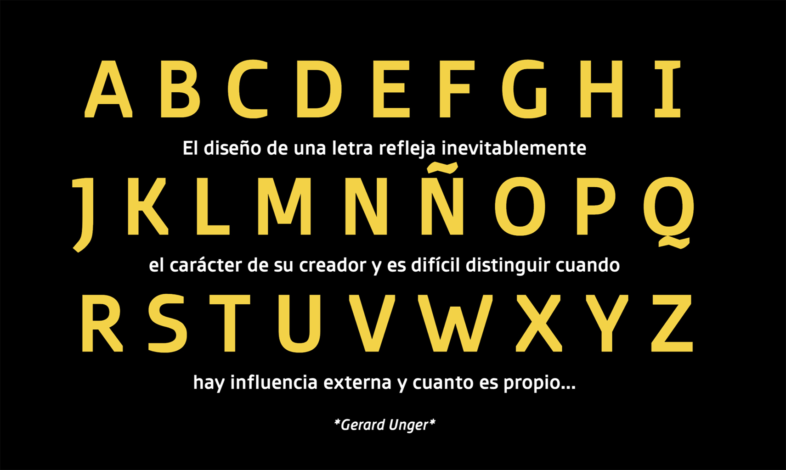
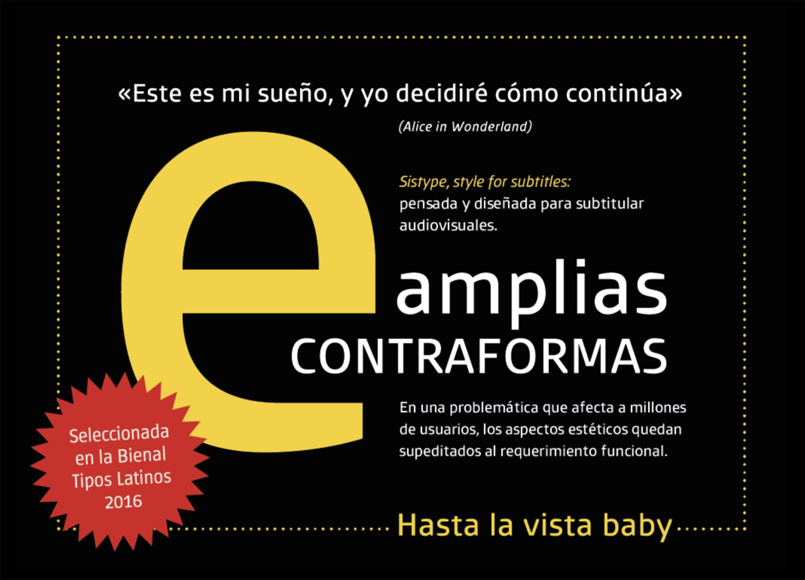
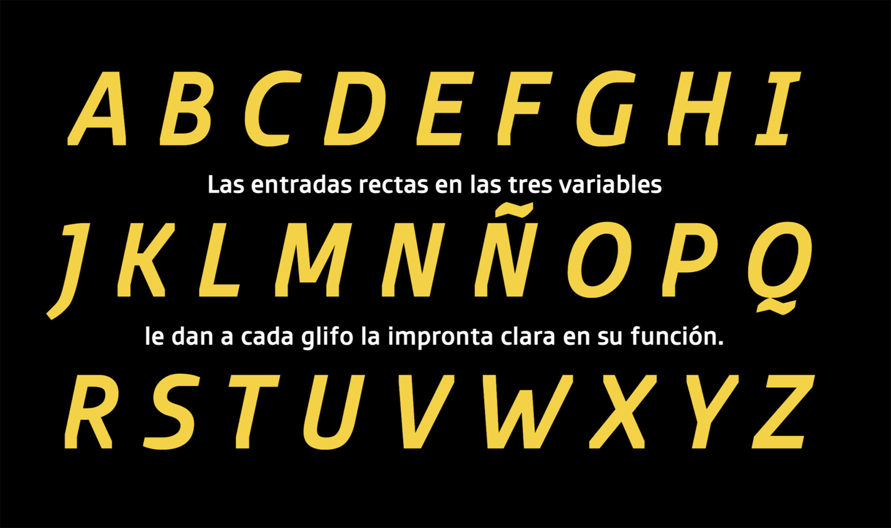

# Sistype

[![][Fontspector]](https://googlefonts.github.io/googlefonts-project-template/fontspector/fontspector-report.html)
[![][OpenType]](https://googlefonts.github.io/googlefonts-project-template/fontspector/fontspector-report.html)
[![][Universal]](https://googlefonts.github.io/googlefonts-project-template/fontspector/fontspector-report.html)
[![][Google Fonts]](https://googlefonts.github.io/googlefonts-project-template/fontspector/fontspector-report.html)
[![][Glyphset]](https://googlefonts.github.io/googlefonts-project-template/fontspector/fontspector-report.html)

[Fontspector]: https://img.shields.io/endpoint?url=https%3A%2F%2Fgooglefonts.github.io%2Fgooglefonts-project-template%2Fbadges%2FFontspectorQA.json
[OpenType]: https://img.shields.io/endpoint?url=https%3A%2F%2Fgooglefonts.github.io%2Fgooglefonts-project-template%2Fbadges%2FOpentypeSpecificationChecks.json
[Universal]: https://img.shields.io/endpoint?url=https%3A%2F%2Fgooglefonts.github.io%2Fgooglefonts-project-template%2Fbadges%2FUniversalProfileChecks.json
[Google Fonts]: https://img.shields.io/endpoint?url=https%3A%2F%2Fgooglefonts.github.io%2Fgooglefonts-project-template%2Fbadges%2FFontFileChecks.json
[Outline Correctness]: https://img.shields.io/endpoint?url=https%3A%2F%2Fgooglefonts.github.io%2Fgooglefonts-project-template%2Fbadges%2FOutlineCorrectnessChecks.json
[Glyphset]: https://img.shields.io/endpoint?url=https%3A%2F%2Fgooglefonts.github.io%2Fgooglefonts-project-template%2Fbadges%2FGlyphsetChecks.json

Designed specifically for digital screens, Sistype takes into account the legacy of the pixel and the way letters are formed through light on a transparent medium. Unlike printed text, on-screen lettering is perceived through illuminated pixels and is often placed over images that are constantly changing. These conditions influence how individual characters are recognized and how words are read. Sistype responds to this environment through a set of deliberate formal and spacing decisions.

Sistype is a humanist sans serif typeface with a classical structure, open counters and medium stroke contrast. Its character is shaped by the relationship between its curves and the straight entry into the counters, a detail that gives the letterforms a distinctive visual identity while supporting clear recognition. The open internal spaces help preserve the definition of each glyph, while the measured contrast between strokes brings visual structure without making the forms overly delicate.

Spacing is central to the typeface's approach to readability. Sistype uses generous letter spacing to help distinguish characters when subtitles appear against complex moving backgrounds. Changes in imagery, texture, brightness and contrast can interfere with the perception of letterforms, making text harder to follow. The wider spacing helps maintain separation between characters and supports a more continuous reading experience. It is not an incidental stylistic feature, but an integral part of the design response to the conditions of audiovisual reading.

The family includes three styles: Regular, Bold and Italic. Together, they provide a compact typographic system that can accommodate different levels of emphasis and hierarchy within subtitles and other on-screen text. Each style maintains the visual coherence of the family while offering a distinct voice for different communication needs.

Sistype approaches subtitles as an integral part of the audiovisual experience rather than as text simply placed over an image. Their role is to communicate spoken content while respecting the visual information unfolding behind them. The typeface seeks a balance between clarity and presence: subtitles should be easy to read, but should not compete unnecessarily with the moving image.

The project is accompanied by a video tutorial for audiovisual professionals. It presents technical aspects of the typeface and offers practical guidance on the use of color to strengthen contrast and improve subtitle readability on screen. This resource extends the project beyond the design of the letterforms, connecting typographic decisions with their application in real audiovisual contexts.

Selected for the 7ma Bienal Tipos Latinos in 2016, Sistype brings together typographic research and a practical response to a specific communication challenge. Its design considers the particular demands of reading on screen, where text and image share the same visual space.

## About

Florencia Sisti Michellod is an Argentine visual communication and type designer based in Buenos Aires, Argentina. She is co-founder of FONTANASISTI, an independent design studio working across branding, editorial design and visual communication. She holds a Master in Typography from the University of Buenos Aires (UBA). Her practice brings together typographic research and design, exploring how letterforms can respond to specific communication needs. Her typeface, Sistype, was selected for the 7ma Bienal Tipos Latinos. In 2026, she led the organization of the Buenos Aires (CABA) venue of the 10ma Bienal Tipos Latinos, coordinating its program, events and activities.

## Building

Fonts are built automatically by GitHub Actions — take a look in the "Actions" tab for the latest build.

If you want to build fonts manually on your own computer:

- `make build` will produce font files.
- `make test` will run [Fontspector](https://fonttools.github.io/fontspector/)'s quality assurance tests.
- `make proof` will generate HTML proof files.

The proof files and QA tests are also available automatically via GitHub Actions — look at `https://yourname.github.io/your-font-repository-name`.

## Changelog

When you update your font (new version or new release), please report all notable changes here, with a date.
[Font Versioning](https://github.com/googlefonts/gf-docs/tree/main/Spec#font-versioning) is based on semver.
Changelog example:

**12 November 2026**

- First addition / QA for GF onboarding (Emma Marichal)

## License

This Font Software is licensed under the SIL Open Font License, Version 1.1.
This license is available with a FAQ at https://openfontlicense.org

## Repository Layout

This font repository structure is inspired by [Unified Font Repository v0.3](https://github.com/unified-font-repository/Unified-Font-Repository), modified for the Google Fonts workflow.
